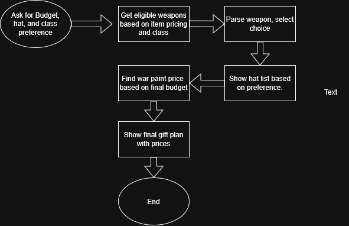

# TF2 Gift Planner

This program plans a TF2 gift given a budget.

## The Problem

When I want to give people TF2 items as a gift, it's inconvient to have to research prices and weapons. That's why I made this.

## How It Works

-Based on budget, hat preference, class preference, it will find eligible items

## Tech Stack

- **Language:** Java
- **Libraries:** 
- **External tools:** Backpack.tf API

## Setup

git clone https://github.com/you/your-project
cd your-project
javac Planner

## Usage
- Java Planner
- Answer the questions

## Roadmap

- [ ] Mutliple weapon qualities
- [ ] Curated Databse
- [ ] Item images

## Author

Nate, https://github.com/nerp1